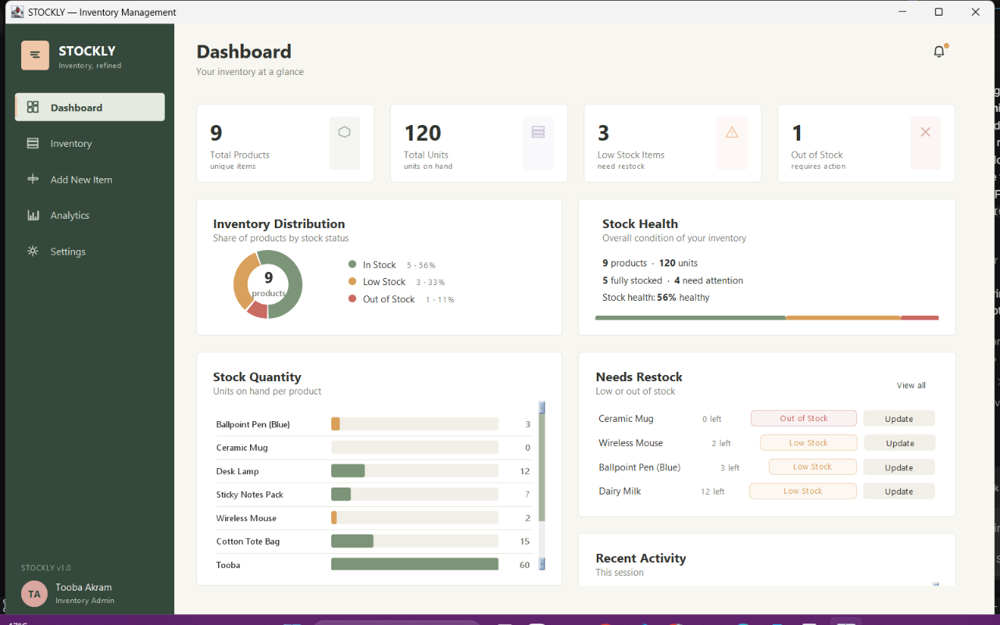
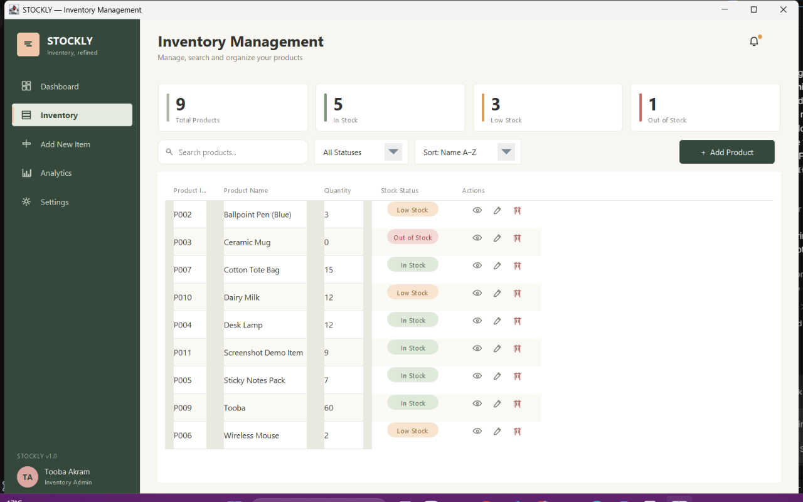
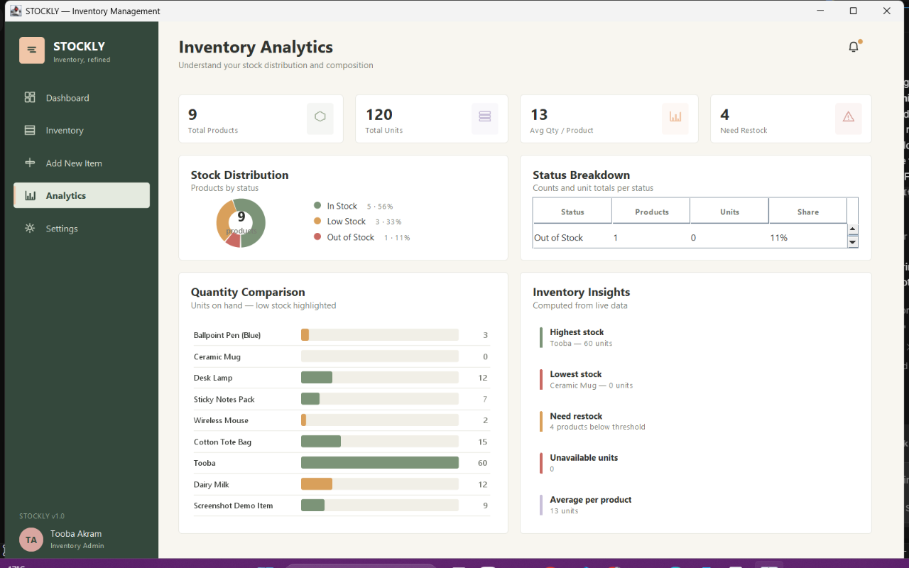
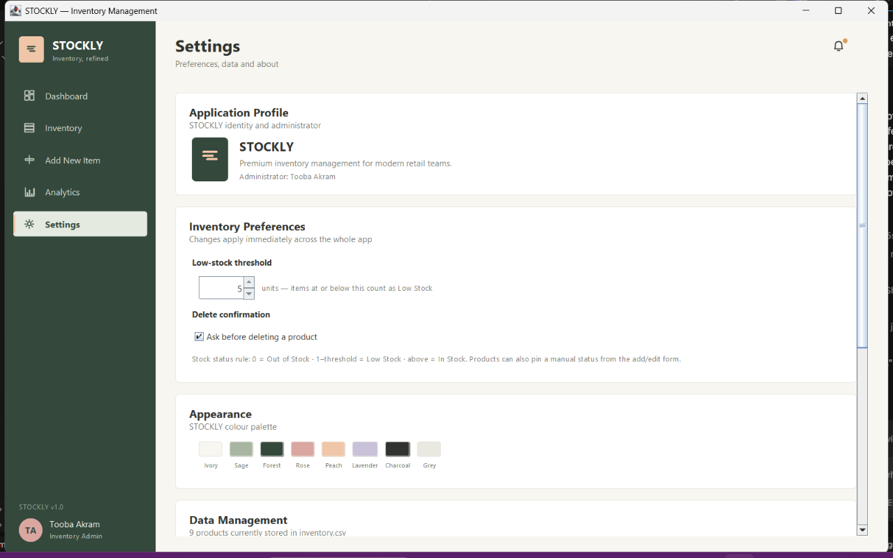

# STOCKLY — Premium Inventory Management System

A polished Java Swing desktop application for managing product inventory:
live dashboard statistics, custom-drawn charts, CSV persistence, a
configurable low-stock threshold and a warm, boutique-retail visual
identity.



## Features

- **Dashboard** — four live KPI cards, a donut chart of stock-status
  distribution, a per-product quantity bar chart (coloured by status),
  a stock-health overview, a "Needs Restock" alert list with quick-edit
  and a session activity feed.
- **Inventory** — stats strip, single toolbar (search, status filter
  incl. "Needs Attention", 4 sort modes, clear-filters), styled table
  with status pills and view/edit/delete row actions, tooltips and a
  designed empty state.
- **Add New Item** — dedicated form page plus a modal add/edit dialog
  with placeholders, a stock-status selector (Auto / In Stock / Low
  Stock / Out of Stock), live status preview and inline validation.
- **Product details** — read-only dialog opened from the table's view
  action, with an Edit shortcut.
- **Analytics** — KPI cards, large distribution donut, status
  breakdown table, quantity comparison bars and auto-calculated
  insight cards. All values computed live; no fabricated trends.
- **Settings** — application profile, low-stock threshold spinner
  (applies instantly app-wide), delete-confirmation toggle, palette
  preview, CSV export/import, clear inventory and an About section.
- **Persistence** — `inventory.csv` (quoted-field safe) survives
  restarts; preferences persist in `stockly.properties`.
- **Stock status** — derived from quantity by default:
  `0` → Out of Stock, `1–threshold` → Low Stock, above → In Stock.
  The threshold defaults to 5 and is configurable in Settings
  (`AppConfig`). Users may optionally pin a manual status per product;
  "Auto" mode keeps status consistent with quantity.
- **Activity log** — every add/update/delete is recorded and shown on
  the dashboard and in the notification bell.

## Requirements

- JDK 8+ (developed and tested on JDK 25 / Temurin)
- No external dependencies — pure Java Swing + Java2D

## Project structure

```
SC OEL/
├── src/
│   └── stockly/
│       ├── Main.java                  # entry point
│       ├── model/
│       │   ├── Product.java           # entity + status logic
│       │   ├── StockStatus.java       # status enum (label + color)
│       │   ├── ActivityEntry.java     # single activity record
│       │   ├── ActivityLog.java       # session activity feed
│       │   ├── AppConfig.java         # persisted preferences
│       │   └── InventoryManager.java  # CRUD, validation, CSV, stats
│       ├── ui/
│       │   ├── Theme.java             # colors, fonts, metrics
│       │   ├── Icon.java              # vector icon set (Graphics2D)
│       │   ├── UIComponents.java      # cards, buttons, badges
│       │   ├── TableKit.java          # table chrome helpers
│       │   ├── Dialogs.java           # styled confirm/notice dialogs
│       │   ├── PromptField.java       # placeholder text field
│       │   ├── ScrollBarKit.java      # thin themed scrollbars
│       │   ├── Sidebar.java           # navigation sidebar
│       │   ├── TopBar.java            # title bar + bell + date
│       │   ├── MainFrame.java         # window shell + page switching
│       │   ├── DashboardPanel.java    # stats + charts + activity
│       │   ├── InventoryPanel.java    # table, filters, row actions
│       │   ├── AddItemPanel.java      # dedicated add-product form
│       │   ├── ProductDialog.java     # modal add/edit form
│       │   ├── ProductDetailsDialog.java # read-only details view
│       │   ├── AnalyticsPanel.java    # analytics views
│       │   └── SettingsPanel.java     # prefs / data / about
│       │   └── charts/
│       │       ├── DonutChart.java    # status distribution donut
│       │       └── QuantityBarChart.java # per-product bar chart
│       └── test/
│           ├── SelfTest.java          # 22 headless model tests
│           ├── UITest.java            # 13 headed UI tests
│           ├── Screenshot.java        # page screenshot utility
│           └── ReportShots.java       # full report screenshot set
├── classes/                           # compiled output
├── docs/
│   ├── javadoc/                       # generated HTML documentation
│   └── screenshots/                   # application screenshots
├── screenshots/                       # report screenshot set (17)
├── inventory.csv                      # persisted data (created on run)
├── stockly.properties                 # saved preferences
└── sources.txt                        # javac file list
```

## Build & run

### Command line

```bash
# compile (regenerate sources.txt only if you add .java files)
javac -d classes -encoding UTF-8 @sources.txt

# run
java -cp classes stockly.Main
```

`inventory.csv` is created automatically in the working directory on
first launch, seeded with demo products. Delete it to reset.

### IntelliJ IDEA

1. Open the project folder (`SC OEL`).
2. `File → Project Structure → Project` → set the SDK to your JDK.
3. Right-click `src` → `Mark Directory as → Sources Root` (optional;
   IDEA detects it automatically).
4. Open `src/stockly/Main.java` and press the green **Run** arrow.

### Eclipse

1. `File → Import → Existing Projects into Workspace` → select folder,
   or create a Java project and copy `src/` in.
2. Set the project JDK under `Properties → Java Build Path`.
3. Run `stockly.Main`.

### VS Code

Open the folder and use the integrated terminal:

```powershell
javac -d classes -encoding UTF-8 @sources.txt
java -cp classes stockly.Main
```

The **Extension Pack for Java** is optional (navigation/autocomplete);
compilation works with the plain JDK on PATH. A ready-made
`.vscode/tasks.json` can be added for Run Task support.

## Testing

Two executable test suites — no framework required:

```bash
java -cp classes stockly.test.SelfTest   # 22 model/business-logic tests
java -cp classes stockly.test.UITest     # 13 headed UI tests
```

Latest executed results: **22/22 PASS** and **13/13 PASS**.
See [TEST_REPORT.md](TEST_REPORT.md) for the full case table.

## Javadoc

Regenerate the HTML documentation with:

```bash
javadoc -d docs/javadoc -encoding UTF-8 -sourcepath src -subpackages stockly
```

Open `docs/javadoc/index.html` in a browser to browse it.

## Version control

See [GIT_GUIDE.md](GIT_GUIDE.md) for the staged commit history,
verification commands and GitHub upload instructions.

## Screenshots

Report set (17 states) in `screenshots/` — regenerate with:

```bash
java -cp classes stockly.test.ReportShots
```

| Dashboard | Inventory |
|---|---|
|  |  |

| Analytics | Settings |
|---|---|
|  |  |

## Design notes

- Palette: warm ivory `#F8F6F0`, sage `#A8B5A0`, forest `#34483C`,
  dusty rose `#D9A6A0`, peach `#F0C6A8`, lavender `#C9C0D9`.
- Charts are drawn with Java2D (`Graphics2D`) — no external chart
  library is required, keeping the project dependency-free and easy
  to explain.
- All statistics are computed from live `InventoryManager` state;
  nothing is hardcoded.
- UI updates flow through `InventoryManager.InventoryListener`, so
  every screen refreshes automatically after any change.

## Author

STOCKLY — built as an OEL (Outcome-Based Education & Learning)
individual project.

## License

Academic project — all rights reserved by the author.
