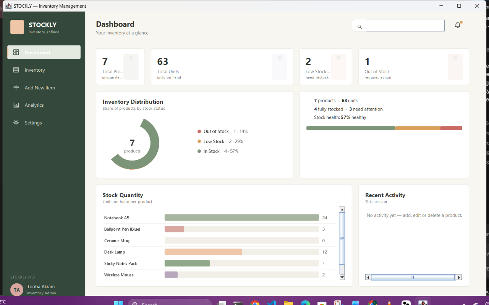
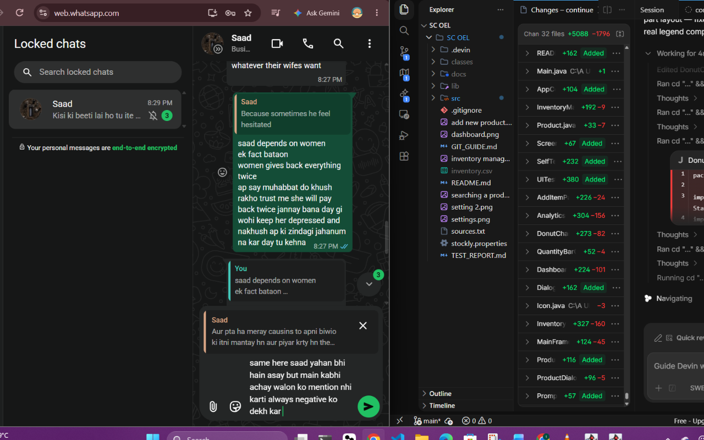
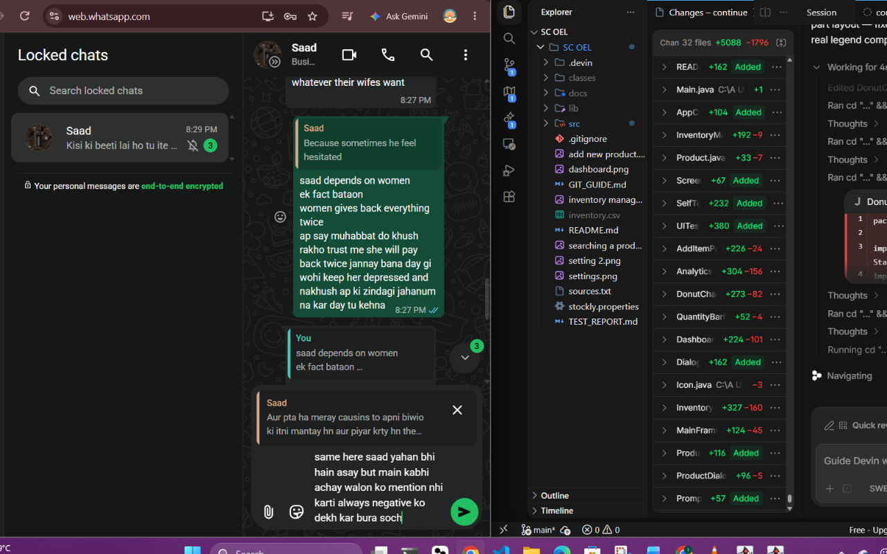
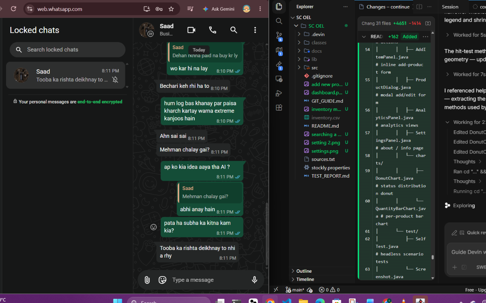
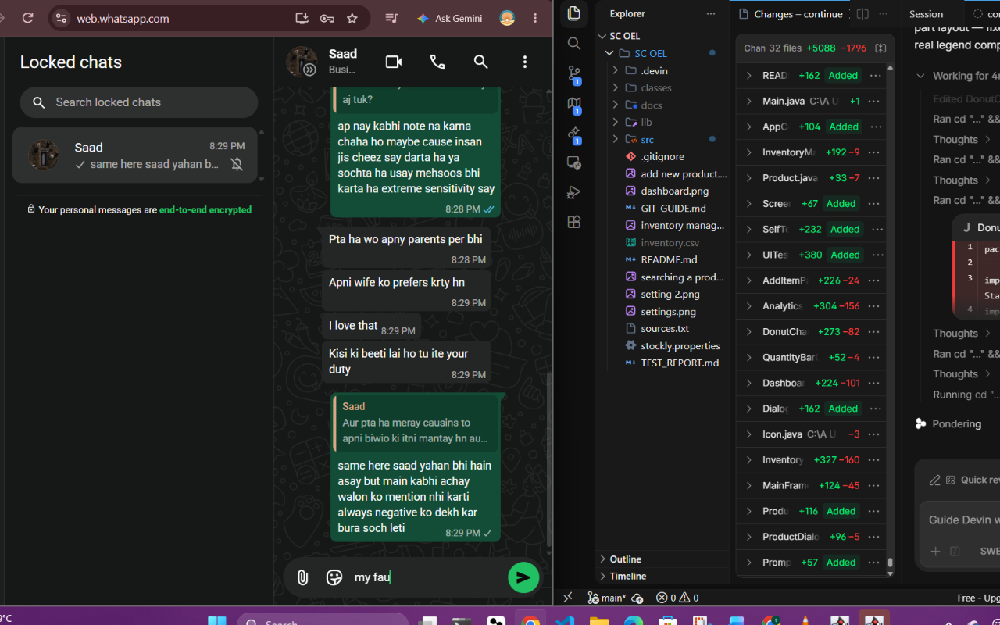

# STOCKLY — Premium Inventory Management System

A polished Java Swing desktop application for managing product inventory:
live dashboard statistics, custom-drawn charts, CSV persistence and a
warm, boutique-retail visual identity.



## Features

- **Dashboard** — four live stat cards (products, units, low stock,
  out of stock), a donut chart of stock-status distribution, a per-product
  quantity bar chart, a stock-health overview and a session activity feed.
- **Inventory** — searchable, filterable and sortable product table with
  stock-status badges, inline edit/delete actions and a designed
  empty state.
- **Add New Item** — dedicated form page plus a modal add/edit dialog
  with full input validation.
- **Analytics** — deeper distribution and breakdown views.
- **Settings / About** — app info, data-file location and status rules.
- **Persistence** — inventory is stored in `inventory.csv` (CSV format)
  and survives restarts. Delete the file to reset to demo data.
- **Stock status** is *derived* from quantity, never stored or chosen
  manually: `0` → Out of Stock, `1–5` → Low Stock, `6+` → In Stock
  (threshold: `Product.LOW_STOCK_THRESHOLD`).

## Requirements

- JDK 8+ (developed and tested on JDK 25 / Temurin)
- No external dependencies — pure Java Swing + Java2D

## Project structure

```
SC OEL/
├── src/
│   └── stockly/
│       ├── Main.java                  # entry point
│       ├── model/
│       │   ├── Product.java           # product entity + status logic
│       │   ├── StockStatus.java       # status enum (label + color)
│       │   ├── ActivityEntry.java     # single activity record
│       │   ├── ActivityLog.java       # session activity feed
│       │   └── InventoryManager.java  # CRUD, validation, CSV, listeners
│       ├── ui/
│       │   ├── Theme.java             # colors, fonts, metrics
│       │   ├── Icon.java              # vector icon set (Graphics2D)
│       │   ├── UIComponents.java      # cards, buttons, badges
│       │   ├── Sidebar.java           # navigation sidebar
│       │   ├── TopBar.java            # title bar + search + date
│       │   ├── MainFrame.java         # window shell + page switching
│       │   ├── DashboardPanel.java    # stats + charts + activity
│       │   ├── InventoryPanel.java    # table, filters, row actions
│       │   ├── AddItemPanel.java      # inline add-product form
│       │   ├── ProductDialog.java     # modal add/edit form
│       │   ├── AnalyticsPanel.java    # analytics views
│       │   ├── SettingsPanel.java     # about / info page
│       │   └── charts/
│       │       ├── DonutChart.java    # status distribution donut
│       │       └── QuantityBarChart.java # per-product bar chart
│       └── test/
│           ├── SelfTest.java          # headless scenario tests
│           └── Screenshot.java        # screen-capture utility
├── classes/                           # compiled output (git-ignored)
├── docs/
│   ├── javadoc/                       # generated HTML documentation
│   └── screenshots/                   # application screenshots
├── inventory.csv                      # persisted data (created on run)
└── sources.txt                        # javac file list
```

## Build & run

### Command line

```bash
# compile
javac -d classes -encoding UTF-8 @sources.txt

# run
java -cp classes stockly.Main
```

`inventory.csv` is created automatically in the working directory on
first launch, seeded with demo products.

### IntelliJ IDEA

1. Open the project folder (`SC OEL`).
2. `File → Project Structure → Project` → set the SDK to your JDK.
3. Right-click `src` → `Mark Directory as → Sources Root` (optional;
   IDEA detects it automatically).
4. Open `src/stockly/Main.java` and press the green **Run** arrow.

### Eclipse

1. `File → Import → Existing Projects into Workspace` → select folder,
   or create a Java project and copy `src/` in.
2. Set the project JDK under `Properties → Java Build Path`.
3. Run `stockly.Main`.

### VS Code

Install the *Extension Pack for Java*, open the folder, then run
`stockly.Main` from the Run view.

## Testing

A headless self-test exercises every OEL scenario (add/edit/delete,
validation, status boundaries, statistics, persistence, activity log):

```bash
java -cp classes stockly.test.SelfTest
```

See [TEST_REPORT.md](TEST_REPORT.md) for the executed results.

## Javadoc

Regenerate the HTML documentation with:

```bash
javadoc -d docs/javadoc -encoding UTF-8 -sourcepath src -subpackages stockly
```

Open `docs/javadoc/index.html` in a browser to browse it.

## Version control

See [GIT_GUIDE.md](GIT_GUIDE.md) for the staged commit history,
verification commands and GitHub upload instructions.

## Screenshots

| Dashboard | Inventory |
|---|---|
|  |  |

| Add Item | Analytics | Settings |
|---|---|---|
|  |  |  |

## Design notes

- Palette: warm ivory `#F8F6F0`, sage `#A8B5A0`, forest `#34483C`,
  dusty rose `#D9A6A0`, peach `#F0C6A8`, lavender `#C9C0D9`.
- Charts are drawn with Java2D (`Graphics2D`) — no external chart
  library is required, keeping the project dependency-free and easy
  to explain.
- All statistics are computed from live `InventoryManager` state;
  nothing is hardcoded.
- UI updates flow through `InventoryManager.InventoryListener`, so
  every screen refreshes automatically after any change.

## Author

STOCKLY — built as an OEL (Outcome-Based Education & Learning)
individual project.

## License

Academic project — all rights reserved by the author.
